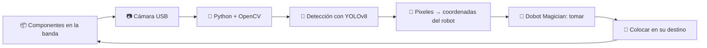

<div align="center">

# 🦾 Dobot Magician · Selector y Colocador de Componentes Electrónicos

### Visión por computador con **YOLO** + brazo robótico + banda transportadora


*Un brazo robótico que **ve**, **identifica** y **clasifica** componentes electrónicos de forma automática.*

</div>

---

## 📖 Tabla de contenido

- [Descripción](#-descripción)
- [¿Cómo funciona?](#-cómo-funciona)
- [Hardware y software](#-hardware-y-software)
- [Avances del proyecto](#-avances-del-proyecto)
- [Estructura del repositorio](#-estructura-del-repositorio)
- [Instalación](#-instalación)
- [Uso](#-uso)
- [Roadmap](#-roadmap)
- [Equipo](#-equipo)

---

## 🎯 Descripción

Este proyecto convierte al **Dobot Magician** en un sistema **selector y colocador (pick & place) de componentes electrónicos**. Una **cámara USB** captura la escena, un modelo **YOLO** (implementado en Python) identifica qué componente es cada objeto y dónde está, y el robot lo toma y lo coloca en su destino. Una **banda transportadora** acoplada al Dobot se encarga de mover los componentes hacia la zona de trabajo.

**Aplicación:** clasificación y organización automática de componentes electrónicos (resistencias, condensadores, LEDs, etc.), reduciendo el trabajo manual y los errores de selección.

## 🧠 ¿Cómo funciona?



1. **Captura:** la cámara USB entrega imágenes en tiempo real.
2. **Detección:** YOLO clasifica cada componente y devuelve su posición en la imagen.
3. **Conversión:** la posición en píxeles se traduce a coordenadas `X, Y, Z` del Dobot.
4. **Manipulación:** el brazo se mueve (modo PTP) hasta el componente, lo toma y lo coloca.
5. **Transporte:** la banda avanza y presenta los siguientes componentes.

## 🧰 Hardware y software

| Componente | Detalle |
|---|---|
| 🦾 Robot | Dobot Magician |
| 🚚 Banda transportadora | Motor paso a paso conectado al Dobot (Stepper 1) |
| 📷 Cámara | USB |
| 🧠 Modelo de visión | YOLOv8 nano (`yolov8n.pt`) con Ultralytics |
| 🐍 Lenguaje | Python |
| 🔌 Control del robot | `DobotDllType` (SDK oficial) y `pydobot` |
| 🔗 Comunicación | Puerto serie (`COM3` por defecto, a 115200 baudios) |

## 🚀 Avances del proyecto

| Fase | Descripción | Estado |
|---|---|---|
| 1️⃣ | Conexión y control del Dobot desde Python | ✅ Completado |
| 2️⃣ | Control de la banda transportadora (velocidad y sentido) | ✅ Completado |
| 3️⃣ | Movimiento simultáneo de banda y brazo | ✅ Completado |
| 4️⃣ | Modelo YOLOv8 y primeras detecciones (`runs/detect`) | ✅ Completado |
| 5️⃣ | Código con cámara USB para detectar componentes | 🔄 En progreso |
| 6️⃣ | Dataset de componentes electrónicos (`Electronic-Component-Picking`) | 🔄 En progreso |
| 7️⃣ | Calibración cámara ↔ robot y ciclo completo de pick & place | ⏳ Pendiente |

> ✏️ Ajusta los estados según el avance real del equipo.

### 🎬 Demostración

*Agrega aquí un GIF o video del robot en funcionamiento:*

```
docs/img/demo.gif
```

## 📁 Estructura del repositorio

```
📦 Proyecto_DobotMagician
├── 📂 Codigo con camara/              # Detección con cámara USB + YOLO
├── 📂 Electronic-Component-Picking-1/ # Datos / entrenamiento de componentes (versión 1)
├── 📂 Electronic-Component-Picking-2/ # Datos / entrenamiento de componentes (versión 2)
├── 📂 Prueba de dobot por python/     # Pruebas de comunicación y movimiento del Dobot
├── 📂 runs/detect/                    # Resultados de detección generados por YOLO
├── 🐍 banda_y_dobot_se_aman.py        # Banda + brazo moviéndose simultáneamente
├── 🐍 movimientodebanda.py            # Control independiente de la banda (pydobot)
└── 🧠 yolov8n.pt                      # Pesos de YOLOv8 nano
```

## ⚙️ Instalación

```bash
# 1. Clonar el repositorio
git clone https://github.com/Jracini/Proyecto_DobotMagician.git
cd Proyecto_DobotMagician

# 2. Instalar dependencias
pip install ultralytics opencv-python pydobot
```

Además necesitas:

- El **SDK / drivers del Dobot** (para `DobotDllType`) y el driver USB del robot.
- El **puerto COM** correcto: ábrelo en el *Administrador de dispositivos* y cámbialo en los scripts si no es `COM3`.

## ▶️ Uso

**Probar la banda transportadora:**

```bash
python movimientodebanda.py
```

**Probar banda + brazo al mismo tiempo:**

```bash
python banda_y_dobot_se_aman.py
```

Este script conecta con el Dobot, enciende la banda (`SetEMotor`), mueve el brazo a `X=250, Y=0, Z=50`, detiene la banda y regresa a la posición *home* `(200, 0, 150)`.

**Detección con cámara:** ejecuta el script dentro de la carpeta `Codigo con camara/`.

> ⚠️ **Seguridad:** despeja el área de trabajo antes de mover el robot y verifica que el sentido y la velocidad de la banda sean los esperados. Si la banda gira al revés, usa velocidad negativa.

## 🗺️ Roadmap

- [x] Comunicación Python ↔ Dobot
- [x] Control de la banda transportadora
- [x] Movimiento simultáneo banda + brazo
- [x] Modelo base YOLOv8n y pruebas de detección
- [ ] Entrenar YOLO con clases de componentes electrónicos
- [ ] Calibración cámara ↔ robot (píxeles → mm)
- [ ] Ciclo completo: detectar → tomar → colocar
- [ ] Sincronizar la banda con la detección
- [ ] Métricas de precisión y tiempo por ciclo

## 👥 Equipo

| Integrante | GitHub |
|---|---|
| Juan Racini  | 
| Leonard Diaz | 
| Mike Salas   |

---

<div align="center">

⭐ Si este proyecto te resultó útil, ¡déjale una estrella! ⭐

</div>
